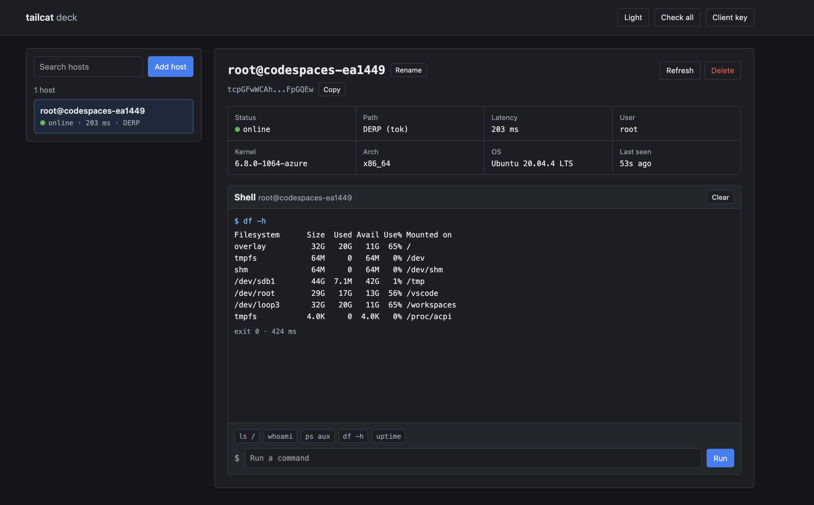

# tailcat deck

A small local web page to manage tailcat hosts.



## Features

- Add and remove tailcat host keys
- Auto-name hosts with `whoami` and `uname`
- Ping one host or all hosts
- Run commands over SSH
- Light and dark mode

## Run

```bash
bun start
```

Open http://127.0.0.1:4747.

## Add a host

On the host:

```bash
tailcat serve no-auth-ssh
```

Copy the `tc...` key it prints and paste it into Add host.

## API

```bash
curl 'http://127.0.0.1:4747/api?act=hosts'
curl -G 'http://127.0.0.1:4747/api' --data-urlencode 'act=ping' --data-urlencode 'key=tc...'
curl -G 'http://127.0.0.1:4747/api' --data-urlencode 'act=shell' --data-urlencode 'key=tc...' --data-urlencode 'act_value=whoami;pwd'
```

No dependencies. Host keys are secrets, and the server only binds to localhost by default.
